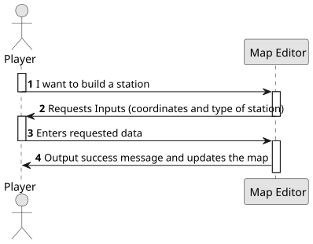

# US05 - Build  Station

## 1. Requirements Engineering

### 1.1. User Story Description

As a Player, I want to build a station.

### 1.2. Customer Specifications and Clarifications

**From the specifications document:**

> The player should be able to build a station at any valid location on the map. Overbuilding is not allowed (a station cannot be built on top of another station). The station's type determines its cost and economic radius.

### 1.3. Acceptance Criteria
A.C 1 : Overbuilding is not possible.

### 1.4. Found out Dependencies

* This User Story has a dependency with US01 "Create a Map" because it is necessary for a map to exist for there to be a station.

### 1.5 Input and Output Data

**Input Data:**

- The coordinates in which the station must be built (x,y);
- Information about which type of station must be built (between Depots, Stations and Terminals);

**Output Data:**

- A success notification saying that the station was built;
- Update the map;

### 1.6. System Sequence Diagram (SSD)

### 1.7 Other Relevant Remarks