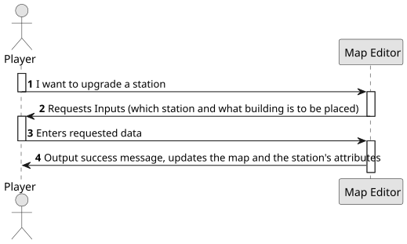

# US06 - Upgrade a Station With a Building

## 1. Requirements Engineering

### 1.1. User Story Description

As a Player, I want to upgrade a selected station with a building.

### 1.2. Customer Specifications and Clarifications

**From the specifications document:**

> The player should be able to select an existing station and upgrade it with available buildings (telegraph [later telephone], café [small or large], customs, post
office, hotel [small or large], silo, liquid storage). The main goal of these buildings are to improve train operation, facilitate train manoeuvers, and increase the lifespan of cargo stored at the station.

### 1.3. Acceptance Criteria
There are no acceptance criteria on this US.

### 1.4. Found out Dependencies

* This User Story has a dependency with US05 "Create a Map" because it is necessary for a station to exist, in order to upgrade it.

### 1.5 Input and Output Data

**Input Data:**

- Select the station that will be upgraded;
- Select the building that will be placed (telegraph, cafe, customs, etc.),

**Output Data:**

- Success message;
- Update the map;
- Update the station's attributes;

### 1.6. System Sequence Diagram (SSD)

### 1.7 Other Relevant Remarks