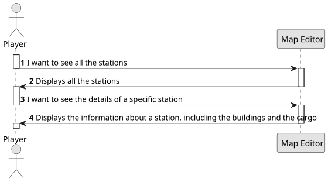

# US007 - Checking the stations and their details

## 1. Requirements Engineering

### 1.1. User Story Description

As a Player, I want to list all the stations to select one to see its details, including the existing building and the demand/supply cargoes.

### 1.2. Customer Specifications and Clarifications

**From the specifications document:**

> The player should be able to check every detail of a station, including all the buildings and all the cargo associated to that station. 
The buildings include telegraphs, cafés, customs, post offices, hotels (that can be either large or small), silos, liquid storage as well as the cargo that is ready for collection and the one that needs to be delivered.

### 1.3. Acceptance Criteria

* There are no acceptance criteria for this User Story

### 1.4. Found out Dependencies

* This User Story requires the US05. This happens, since in order to list all the stations, there need to be stations created.

### 1.5 Input and Output Data

**Output Data:**

- Listing of all the stations, with their associated building and their supply/demand cargoes.

### 1.6. System Sequence Diagram (SSD)

### 1.7 Other Relevant Remarks