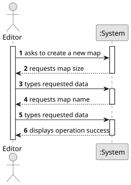

# US001 - Create a Map

## 1. Requirements Engineering

### 1.1. User Story Description
As an Editor, I want to create a map with a size and a name.

### 1.2. Customer Specifications and Clarifications

#### From the specifications document:
- A map must have a unique name.
- A map must have defined dimensions (width x height).
- The editor should be able to specify these attributes during creation.

### 1.3. Acceptance Criteria
- **AC1:** The maps dimensions are positive integers.
- **AC2:** Map name should be a valid file name.

### 1.4. Found Dependencies
- None.

### 1.5. Input and Output Data

#### Input Data:
- Typed data:
  - Map name (unique)
  - Map size (width x height)

#### Output Data:
- Confirmation of successful map creation
- Error message if creation fails (e.g., duplicate name, invalid size)

### 1.6. System Sequence Diagram (SSD)

**_Other alternatives might exist._**

### 1.7. Other Relevant Remarks
- None.