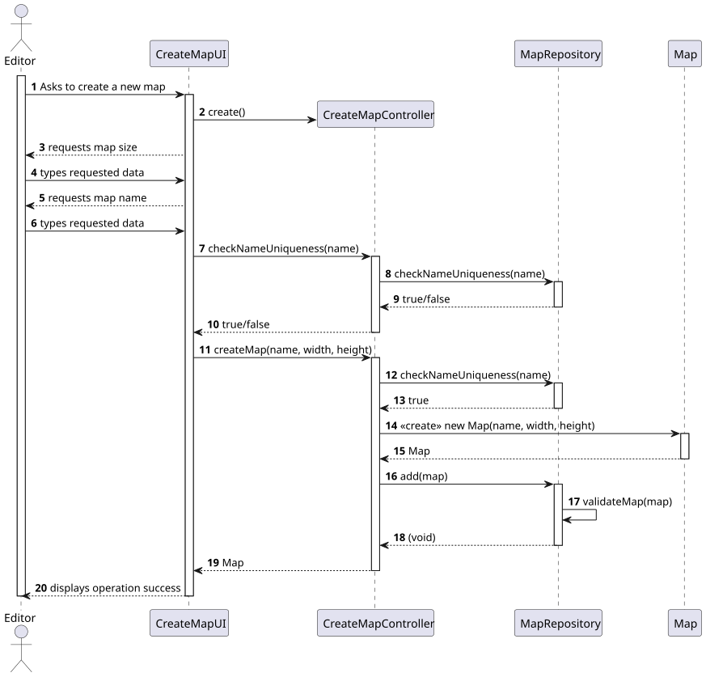
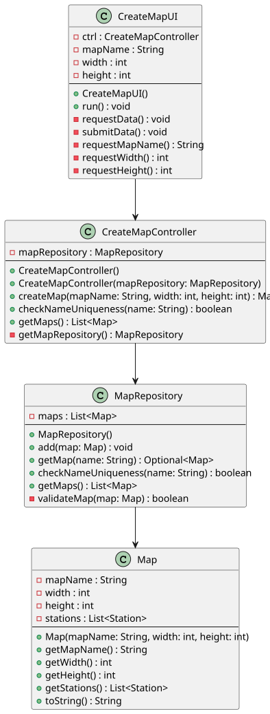

# US001 - Create a Map

## 3. Design

### 3.1. Rationale

**The rationale grounds on the SSD interactions and the identified input/output data.**

| Interaction ID                          | Question: Which class is responsible for...                | Answer              | Justification (with patterns)         |
|:----------------------------------------|:-----------------------------------------------------------|:--------------------|:--------------------------------------|
| Step 1 - Asks create a new map		        | ...instantiating the class that handles the UI?							     | CreateMapUI         | Pure Fabrication                      |
| 		                                      | ...coordinating the US?							                             | CreateMapController | Controller                            |
| Step 2 - Requests map size   		         | ...displaying the form for the actor to input data?							 | CreateMapUI         | Pure Fabrication                      |
| Step 3 - Types requested data  		       | ...validating typed/selected data?							                  | CreateMapUI         | Pure Fabrication                      |
| Step 4 - Requests map name		            | ...temporarily keeping the data?							                    | CreateMapUI         | Pure Fabrication                      |
| Step 5 - Types requested data           |                                                            |                     |                                       |
| 		                                      | ...getting instances of repositories?							               | Repositories        | Information Expert, Pure Fabrication  |              
| 		                                      | ...get Map repository?							                              | Repositories        | Information Expert, Pure Fabrication  |
| 		                                      | ...creating the Map Object?							                         | MapRepository       | Creator                               |
| 		                                      | ...validating the data locally?							                     | Map                 | Information Expert                    |
| 		                                      | ...return the simulation's data?							                    | MapRepository       | Information Expert, Pure Fabrication  |   
| Step 6 - Displays operation success		   | ...displaying operation success message?							            | CreateMapUI         | Pure Fabrication                      |  

### Systematization ##

According to the taken rationale, the conceptual classes promoted to software classes are:

* Repositories
* MapRepository
* Map

Other software classes (i.e. Pure Fabrication) identified:

* CreateMapUI
* CreateMapController

## 3.2. Sequence Diagram (SD)

_In this section, it is suggested to present an UML dynamic view representing the sequence of interactions between software objects that allows to fulfill the requirements._

### Full Diagram

This diagram shows the full sequence of interactions between the classes involved in the realization of this user story.

## 3.3. Class Diagram (CD)

_In this section, it is suggested to present an UML static view representing the main related software classes that are involved in fulfilling the requirements as well as their relations, attributes and methods._

