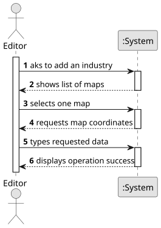

# US002 - Add an Industry to the Map

## 1. Requirements Engineering

### 1.1. User Story Description
As an Editor, I want to add an industry in a position (X, Y) of the selected map.

### 1.2. Customer Specifications and Clarifications

#### From the specifications document:
- An industry must be placed at a specific (X, Y) position on an existing map.
- Each industry belongs to a predefined industry type.

### 1.3. Acceptance Criteria
- In this version there is no acceptance criteria.
  
### 1.4. Found Dependencies
- Requires a map to exist before adding an industry (depends on US001 - Create a Map).

### 1.5. Input and Output Data

#### Input Data:
- Selected map
- Typed data:
  - Industry type (e.g., Steel Mill, Coal Mine, Textile Factory)
  - X-coordinate
  - Y-coordinate

#### Output Data:
- Confirmation of successful industry placement
- Error message if placement fails (e.g., invalid position, industry overlap)

### 1.6. System Sequence Diagram (SSD)

**_Other alternatives might exist._**

### 1.7. Other Relevant Remarks
- The system should ensure that industries do not overlap existing elements on the map.
- Industry types should be selected from a predefined list to maintain consistency.
