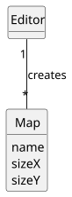
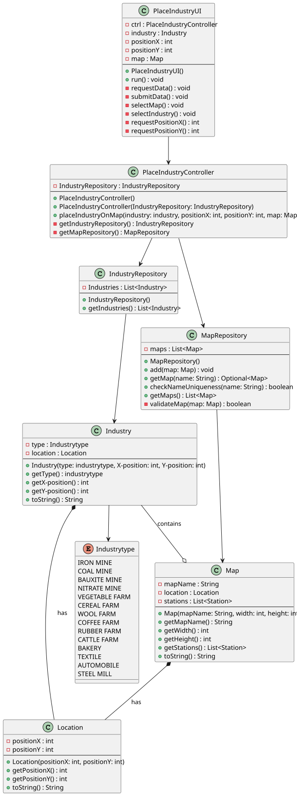

# US002 - Add an Industry to the Map

## 3. Design

### 3.1. Rationale

**The rationale grounds on the SSD interactions and the identified input/output data.**

| Interaction ID                        | Question: Which class is responsible for...                | Answer             | Justification (with patterns)        |
|:--------------------------------------|:-----------------------------------------------------------|:-------------------|:-------------------------------------|
| Step 1 - aks to add an industry		     | ...instantiating the class that handles the UI?							     | PlaceIndustryUI    | Pure Fabrication                     |
| 		                                    | ...coordinating the US?							                             | PlaceIndustryController    | Controller                           |
| Step 2 - shows list of maps   		      | ...displaying the form for the actor to input data?							 | PlaceIndustryUI    | Pure Fabrication                     |
| Step 3 - selects one map  		          | ...validating typed/selected data?							                  | PlaceIndustryUI    | Pure Fabrication                     |
| Step 4 - requests map coordinates		   | ...temporarily keeping the data?							                    | PlaceIndustryUI    | Pure Fabrication                     |
| Step 5 - types requested data         |                                                            |                    |                                      |
| 		                                    | ...getting instances of repositories?							               | Repositories       | Information Expert, Pure Fabrication |              
| 		                                    | ...get Map repository?							                              | Repositories       | Information Expert, Pure Fabrication |
| 		                                    | ...creating the Map Object?							                         | IndustryRepository | Creator                              |
| 		                                    | ...validating the data locally?							                     | Industry           | Information Expert                   |
| 		                                    | ...return the simulation's data?							                    | IndustryRepository | Information Expert, Pure Fabrication |   
| Step 6 - Displays operation success		 | ...displaying operation success message?							            | PlaceIndustryUI    | Pure Fabrication                     |  

### Systematization ##

According to the taken rationale, the conceptual classes promoted to software classes are:

* Repositories
* IndustryRepository
* Industry

Other software classes (i.e. Pure Fabrication) identified:

* PlaceIndustryUI
* PlaceIndustryController

## 3.2. Sequence Diagram (SD)

_In this section, it is suggested to present an UML dynamic view representing the sequence of interactions between software objects that allows to fulfill the requirements._

### Full Diagram

This diagram shows the full sequence of interactions between the classes involved in the realization of this user story.

## 3.3. Class Diagram (CD)

_In this section, it is suggested to present an UML static view representing the main related software classes that are involved in fulfilling the requirements as well as their relations, attributes and methods._

