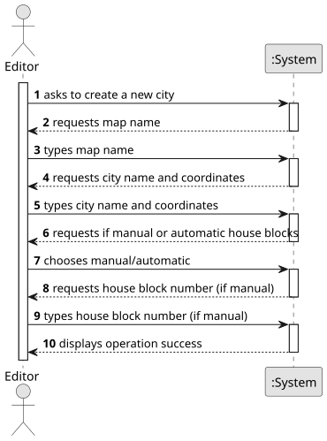

# US003 - Add a City to the Map

## 1. Requirements Engineering

### 1.1 User Story Description
As an Editor, I want to add a city in a position XY of the selected map, with a name and a positive number of house blocks.

### 1.2 Customer Specifications and Clarifications

#### From the customer's clarifications:
> Question:Is there a minimum or maximum number of house blocks that can be assigned?
>
> Answer: The number needs to be a positive on; there is no maximum, it's up to the editor to decide.

> Question: According to User Story 3, sir, can the name of the city have spaces in its nomenclature?
>
> Answer: yes you can, “Torres Novas” for example.

> Question: According to User Story 3, the name of the city must be unique within the same map?
>
> Answer: It can be repeated but can become confusing for players, the editor should be alerted to the situation.

> Question: What is the purpose and meaning of the "City Tag"?
>
> Answer: It's a label that would appear in the map if a GUI is considered.

> Question: Does the city have a specific radius for some functionality or is the city creation just figurative?
>
> Answer: No, it's the center, that can be useful if the positions for the House Blocks as randomly generated.

> Question: Does that influence passenger statistics or will there be no statistics for a specific city?
>
> Answer: The statistics will about stations and the railroad network not about cities.

#### From the specifications document:
- Each city must have:
  - A unique name per map.
  - A specific XY coordinate (position on the map grid).
  - A positive number of house blocks, which can be set manually or generated randomly.

### 1.3 Acceptance Criteria
- **AC1:** A city name cannot contain special characters or digits; only alphabetic characters are allowed.
- **AC2:** The number of house blocks can be:
  - Assigned manually (by user input), OR
  - Generated automatically/randomly around the city’s tag position (XY coordinate).

### 1.4 Dependencies
- Requires the existence of a previously created Map (US001).
- Editor must have selected a map before adding the city.

### 1.5 Input and Output Data

**Input Data:**
- Name of the city (alphabetic only).
- XY coordinates (position on the map grid).
- Number of house blocks (manual input) OR Random generation option.

**Output Data:**
- Confirmation message of city creation.
- Display of city name, position, and house blocks on the map.

### 1.6. System Sequence Diagram (SSD)

**_Other alternatives might exist._**

### 1.7 Other Relevant Remarks
- The house blocks, when assigned automatically, should be generated randomly within a predefined radius around the city's XY coordinates.
- There should be a mechanism to ensure that cities are not overlapping with industries or other cities.
