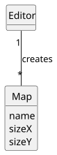
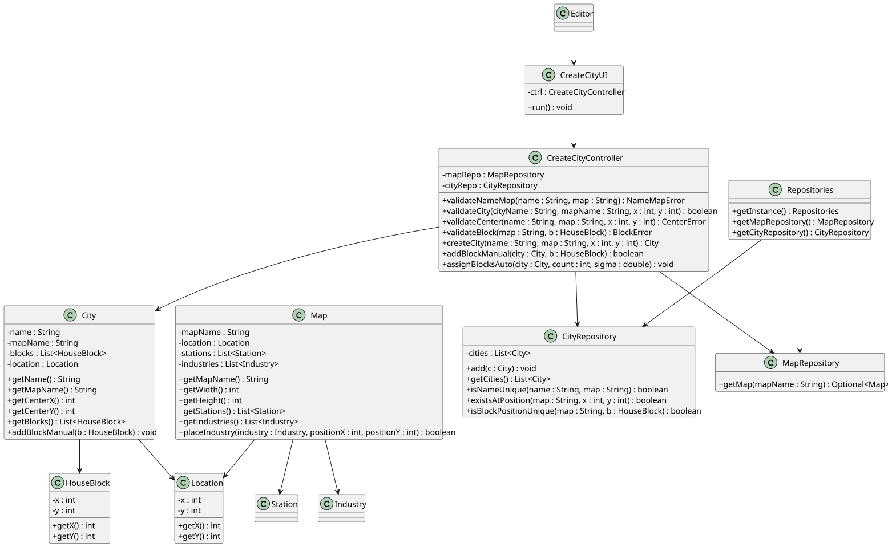

# US003 - Add a City to the Map

## 3. Design

### 3.1. Rationale

**The rationale grounds on the SSD interactions and the identified input/output data.**

| Interaction ID                                        | Question: Which class is responsible for...                | Answer               | Justification (with patterns)        |
|:------------------------------------------------------|:-----------------------------------------------------------|:---------------------|:-------------------------------------|
| Step 1 - asks to create a new city		                  | ...instantiating the class that handles the UI?							     | CreateCityUI         | Pure Fabrication                     |
| 		                                                    | ...coordinating the US?							                             | CreateCityController | Controller                           |
| Step 2 - shows list of maps   		                      | ...displaying the form for the actor to input data?							 | CreateCityUI         | Pure Fabrication                     |
| Step 3 - chooses one map  		                          | ...validating typed/selected data?							                  | CreateCityUI         | Pure Fabrication                     |
| Step 4 - requests city name and coordinates		         | ...temporarily keeping the data?							                    | CreateCityUI         | Pure Fabrication                     |
| Step 5 - types city name and coordinates              |                                                            |                      |                                      |
| 		                                                    | ...getting instances of repositories?							               | Repositories         | Information Expert, Pure Fabrication |              
| 		                                                    | ...get City repository?							                             | Repositories         | Information Expert, Pure Fabrication |
| 		                                                    | ...creating the Map Object?							                         | CityRepository       | Creator                              |
| 		                                                    | ...validating the data locally?							                     | City                 | Information Expert                   |
| 		                                                    | ...return the simulation's data?							                    | CityRepository       | Information Expert, Pure Fabrication |
| Step 6 - requests if manual or automatic house blocks | ...creating the HouseBlock Object?					         | CityRepository       | Creator                              |
| Step 7 - chooses manual/automatic                     |                                                           |                      |                                      |
|requests house block number (if manual)             | ...validating the data locally?							                     | City                 | Information Expert                   |
| 		                                                    | ...return the simulation's data?							                    | CityRepository       | Information Expert, Pure Fabrication |
| Step 8 - types house block number (if manual)        | ...creating the HouseBlock Object?					         | CityRepository       | Creator                              |
| Step 9 - creates the city object                      | ...validating the data locally?							                     | City                 | Information Expert                   |
| 		                                                    | ...return the simulation's data?							                    | CityRepository       | Information Expert, Pure Fabrication |
| 		                                                    | ...creating the City Object?					         | CityRepository       | Creator                              |
| 		                                                    | ...creating the HouseBlock Object?					         | CityRepository       | Creator                              |
| Step 10 - Displays operation success		                | ...displaying operation success message?							            | CreateCityUI         | Pure Fabrication                     |  

### Systematization ##

According to the taken rationale, the conceptual classes promoted to software classes are:

* Repositories
* CityRepository
* City

Other software classes (i.e. Pure Fabrication) identified:

* CreateCityUI
* CreateCityController

## 3.2. Sequence Diagram (SD)

### Full Diagram

This diagram shows the full sequence of interactions between the classes involved in the realization of this user story.

## 3.3. Class Diagram (CD)

