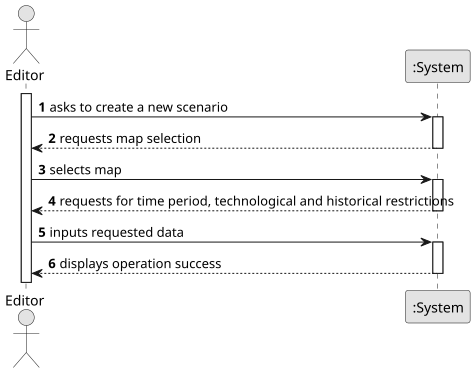
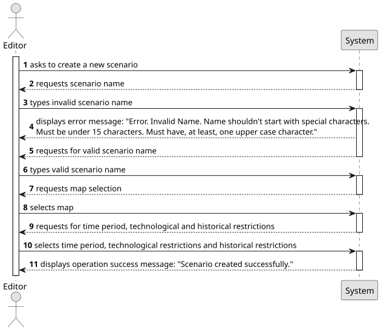
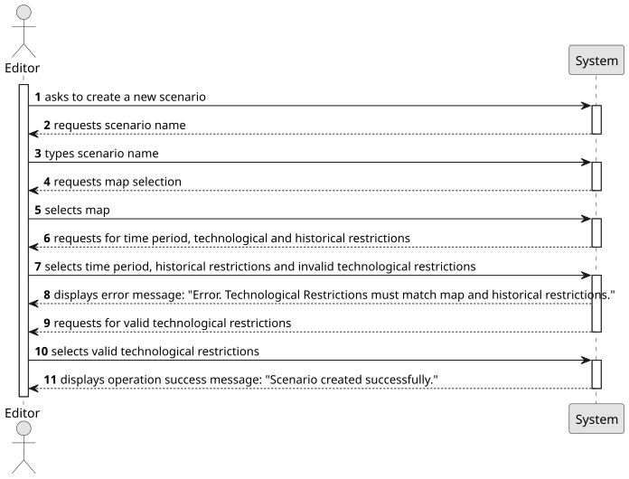
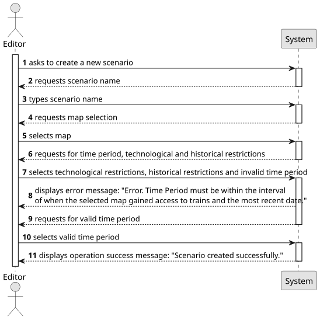

# US004 - Create a Scenario

## 1. Requirements Engineering

### 1.1. User Story Description
As an Editor, I want to create a scenario for a selected map.

### 1.2. Customer Specifications and Clarifications

#### From the customer's clarifications:
> Question: Can scenarios be modified after creation, or are they immutable?
> Answer:
>
> Question: What happens if an Editor tries to set conflicting restrictions (for example allowing a locomotive that wasn’t invented yet)?
> Answer:
> 
> Question: What elements are included in a scenario? For example, cities, industries, or specific objectives by default?
> Answer:
> 
> Question: Are there predefined scenarios, or should users be able to create custom ones from scratch?
> Answer:
> 
> Question: How should scenarios be linked to a selected map? Can one map have multiple scenarios?
> Answer:
> 
> Question: What is the process for selecting a map when creating a scenario?
> Answer:
> 
> Question: Should scenarios include time-based components, such as start and end dates or time-specific events?
> Answer:
> 
> Question: Are there any historical elements or themes that need to be incorporated into scenarios?
> Answer:
>
> Question: What level of customization should be available to users when creating scenarios?
> Answer:
>
> Question: Could you specify the information that needs to be stored about each scenario?
> Answer:
#### From the specifications document:
> The Scenario Editor must allow the user to define the restrictions and
conditions for using a given map, namely:
>
>• Time Restrictions - the period in which the simulation will take place;
>
>• Technological Restrictions - for example, which locomotives or indus-
tries are available in the scenario;
>
>• Historical Restrictions - historical events that make sense in the sce-
nario and change the operating conditions of the simulator. For in-
stance, a war increases the steel demand, and a vaccination campaign
or a schooling program encourages mail and/or passenger traffic. In
this context, the goods that the Ports import and export are also de-
fined.

### 1.3. Acceptance Criteria
AC1: Definition of the behaviour of ports, which cargoes they import/export and/or transform;
AC2: Definition of the available locomotion types (steam, diesel, and/or electric).
AC3: (Re)Definition of the factors that alter the generation (frequency) of generating industries

### 1.4. Found Dependencies
- This user story has a dependency with US001 - "Create a map" as there has to exist a map for a scenario to be made.

### 1.5. Input and Output Data

#### Input Data:
- Typed Data:
  - Scenario name

- Selected Data:
  - Map selection
  - Time Period
  - Technological Restrictions
  - Historical Restrictions

#### Output Data:
- Confirmation of successful scenario creation
- Error message if creation fails (e.g., invalid map)

### 1.6. System Sequence Diagram (SSD)

**_Other alternatives might exist._**

### 1.7. Other Relevant Remarks
- None.