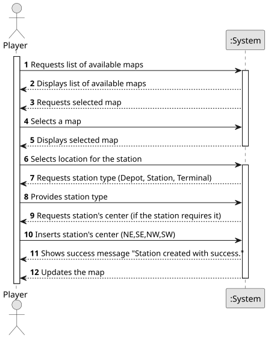
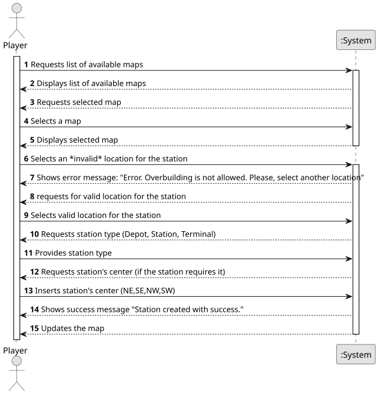
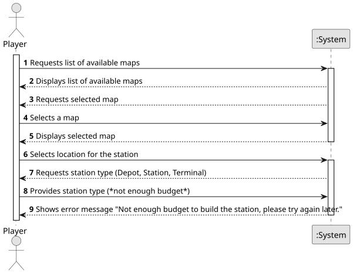

# US05 - Build a Station

## 1. Requirements Engineering

### 1.1. User Story Description

As a Player, I want to build a station (Depot, Station or Terminal) in the current map. The system should
also propose the name for the station based on the closest city and type of station. Not only that, if the station's type if either Depot or Terminal, the center of the station should be defined by the player (NE,SE,NW,SW).

### 1.2. Customer Specifications and Clarifications

**From the customer's clarifications:**
> Question:
What is the input data for the user story 5? Is there any input besides the type of the station?
>
> Answer: Position; Station type (Terminal, Station or Depot) and, in the case of the station, the center must be filled in. If the proposed is not accepted an alternative one must be entered.

> Question:
Is the budget the only concern to build a station, or does the player also needs to have other specific resources, like steel, etc.? Are resources included on the budget, or the budget represent only the player's monetary value?
>
> Answer: Just the budget in a generic currency.

**From the specifications document:**

> The player should be able to build a station at any location on the map (the location should be validated beforehand). Overbuilding is not allowed (a station cannot be built on top of another station). The station's type have different costs and economic radius. Stations should also be able to connect to other stations by routes.

### 1.3. Acceptance Criteria
A.C 1 : Overbuilding is not possible.

### 1.4. Found out Dependencies

* This User Story has a dependency with US01 "Create a Map" because it is necessary for a map to exist for there to be a station.

### 1.5 Input and Output Data

**Input Data:**

- The coordinates in which the station must be built (x,y);
- Information about which type of station must be built (between Depots, Stations and Terminals);
- The definition of the center (if the station is either a Depot or a Terminal);

**Output Data:**

- A success notification saying that the station was built;
- An error notification if the location was invalid, or there isn't enought budget to buy;
- Update the map with the newly placed station;
- A system-generated name for the newly built station, based on its type and nearest city name;

### 1.6. System Sequence Diagram (SSD)

#### Success Case

#### Input Error: Overbuilding

#### Action Error: Not Enough Budget

### 1.7 Other Relevant Remarks
- None