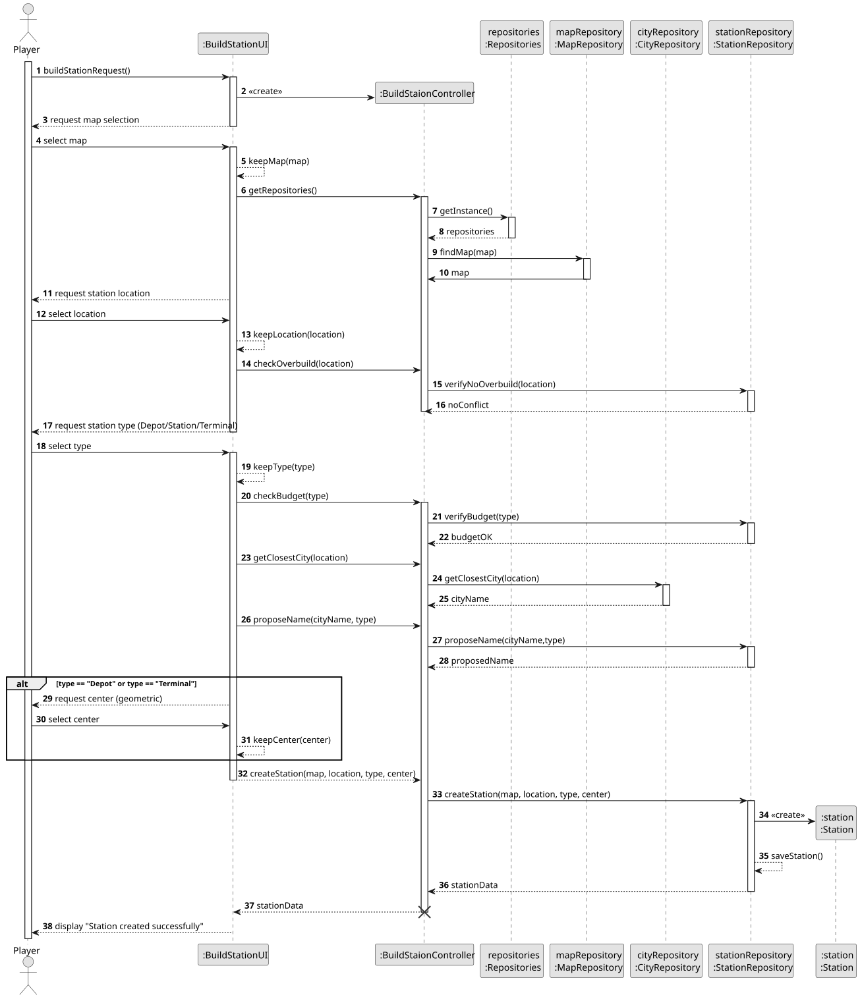
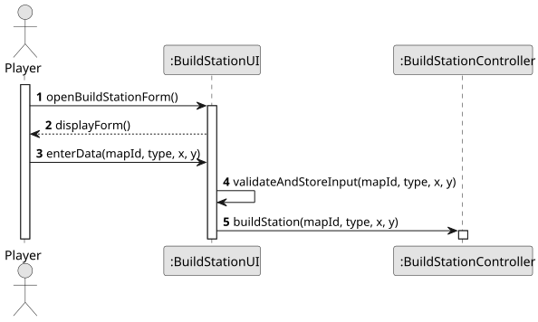
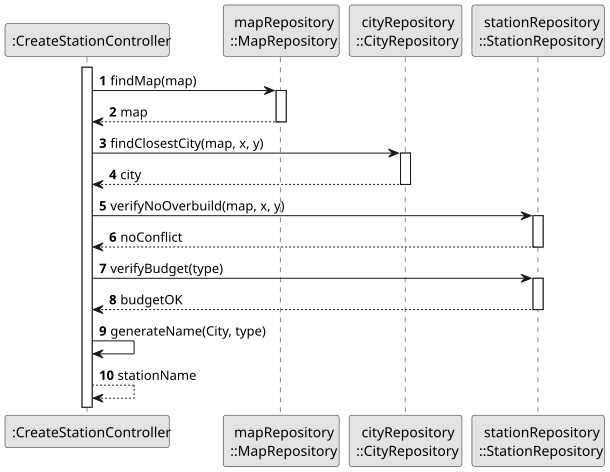
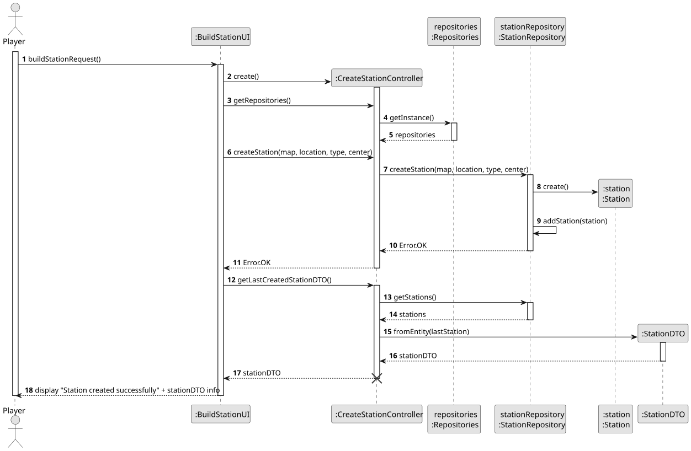

# US005 - Build a Station

## 3. Design

### 3.1. Rationale

**The rationale grounds on the SSD interactions and the identified input/output data.**

| Interaction ID                       | Question: Which class is responsible for...               | Answer                        | Justification (with patterns)        |
|:-------------------------------------|:----------------------------------------------------------|:------------------------------|:-------------------------------------|
| Step 1 - Requests to build station		 | ...instantiating the class that handles the UI?						     | BuildStationUI                | Pure Fabrication                     |
| 		                                   | ... coordinating the US?							                           | BuildStationController        | Controller                           |
| Step 2 - Requests input data		       | ...displaying the form for the actor to input data?						 | BuildStationUI                | Pure Fabrication                     |
| Step 3 - Types/selects station data  | ...validating typed/selected data?                        | BuildStationUI                | Pure Fabrication                     |
|                                      | ...temporarily keeping the data?                          | BuildStationUI                | Pure Fabrication                     |
|                                      | ...get instances of repositories?                         | Repositories                  | Information Expert, Pure Fabrication |
|                                      | ...get map and city to determine placement?               | MapRepository, CityRepository | Information Expert                   |
|                                      | ...creating the Station object?                           | StationRepository             | Creator                              |
|                                      | ...validating the data locally?                           | Station                       | Information Expert                   |
|                                      | ...return the station's data?                             | StationRepository             | Information Expert, Pure Fabrication |
|                                      | ...displaying operation success message?                  | BuildStationUI                | Pure Fabrication                     |

### Systematization ##

According to the taken rationale, the conceptual classes promoted to software classes are:

* Repositories
* StationRepository
* Station
* MapRepository
* CityRepository

Other software classes (i.e. Pure Fabrication) identified:

* BuildStationUI
* BuildStationController

## 3.2. Sequence Diagram (SD)

_In this section, it is suggested to present a UML dynamic view representing the sequence of interactions between software objects that allows to fulfill the requirements._

### Full Diagram

This diagram shows the full sequence of interactions between the classes involved in the realization of this user story.

### Split Diagrams

The following diagram shows the same sequence of interactions between the classes involved in the realization of this user story, but it is split in partial diagrams to better illustrate the interactions between the classes.

It uses Interaction Occurrence (a.k.a. Interaction Use).

**Get Input Partial SD**

**Validate and Name Station Partial SD**

**Create Station and Display Success Partial SD**

## 3.3. Class Diagram (CD)

_In this section, it is suggested to present an UML static view representing the main related software classes that are involved in fulfilling the requirements as well as their relations, attributes and methods._

