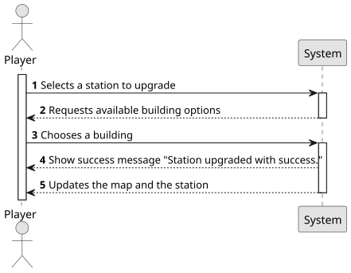

# US06 - Upgrade a Station With a Building

## 1. Requirements Engineering

### 1.1. User Story Description

As a Player, I want to upgrade a selected station with a building.Each type of station improvement has a date from which it is available.
Some equipments are mutually exclusive, while some equipments/buildings replace others.

### 1.2. Customer Specifications and Clarifications

**From the customer's clarifications:**
> Question:
Is there a limit on the number of buildings a station can be upgraded with?
>
> Answer:
No;

> Question:
Does the upgrade from telegraph to telephone occur automatically once a certain year is reached?
>
> Answer: There are no automatic updates; When a new building is available, the player can buy it and then the previous building is replaced.

> Question:
No enunciado, é dado o exemplo do small hotel e large hotel como equipamentos mutuamente exclusivos. Isso significa que todos os upgrades do mesmo tipo são sempre mutuamente exclusivos? Ou, por exemplo, é possível ter mais de uma unidade de liquid storage na mesma estação?
>
> Answer: Existem edícifios mutamente exlusivos como restaurante pequeno e restaurante grande. Existem edificios que quando passam a existir, deixa de ser possivel construir o anterior, por exemplo, o telegrafo foi substituido pelo telefone. As estações que tenham telegrafo continuam com o telegrafo a funcionar até que seja construido um telefone que substitua o telegrafo. A partir do momento que existe telefone já não é possivel construir um telegrafo.

> Question:
Além disso, gostaria de confirmar se é possível ter múltiplos buildings de tipos diferentes na mesma estação. Por exemplo, podemos ter um small café, um large hotel e um post office simultaneamente?
>
> Answer: Não podem existir multiplos edificios iguais (por exemplo, não posso ter 3 silos de cereais)

> Question:
Caso seja permitido, existe um limite máximo para a quantidade de buildings em cada estação?
Se esse limite existir, ele varia conforme o tipo de estação (Depot, Station ou Terminal)?
Todas as combinações de edifícios são permitidas? Por exemplo, o Player tem liberdade de escolher ter na mesma estação os upgrades: customs + silo + telegraph
>
> Answer: As combinações, desde que respeitando as restrições anteriomente referidas, são todas possíveis.

**From the specifications document:**

> The player should be able to select an existing station and upgrade it with available buildings (telegraph [later telephone], café [small or large], customs, post
office, hotel [small or large], silo, liquid storage). The main goal of these buildings are to improve train operation, facilitate train manoeuvers, and increase the lifespan of cargo stored at the station. Not only that, some equipments/buildings are mutually exclusive (small and grand hotels, for example) and some equipments/buildings replace others.

### 1.3. Acceptance Criteria
There are no acceptance criteria on this US.

### 1.4. Found out Dependencies

* This User Story has a dependency with US04 "Create a Scenario", because US06 mentions "dates of availability", which will be defined in the creation of the scenario.
* This User Story has a dependency with US05 "Build a Station", because it is necessary for a station to exist, in order to upgrade it.

### 1.5 Input and Output Data

**Input Data:**

- Select the station that will be upgraded;
- Select the building that will be placed (telegraph, cafe, customs, etc.),

**Output Data:**

- Success or failure message;
- Update the map;
- Update the station's attributes;

### 1.6. System Sequence Diagram (SSD)

### 1.7 Other Relevant Remarks
- None