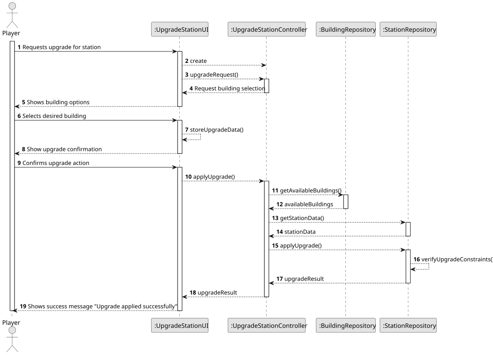
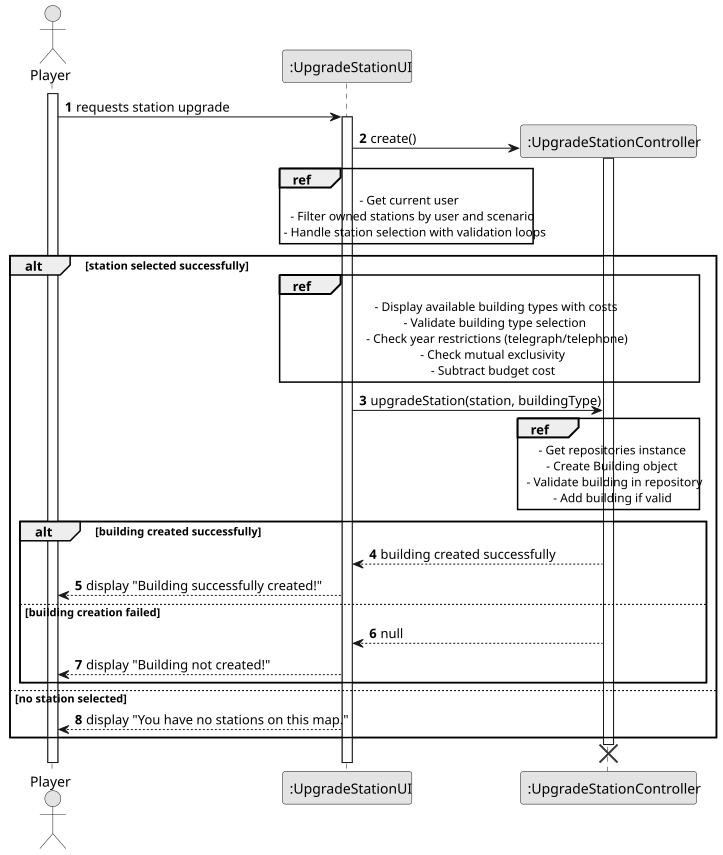
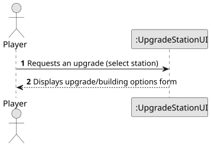
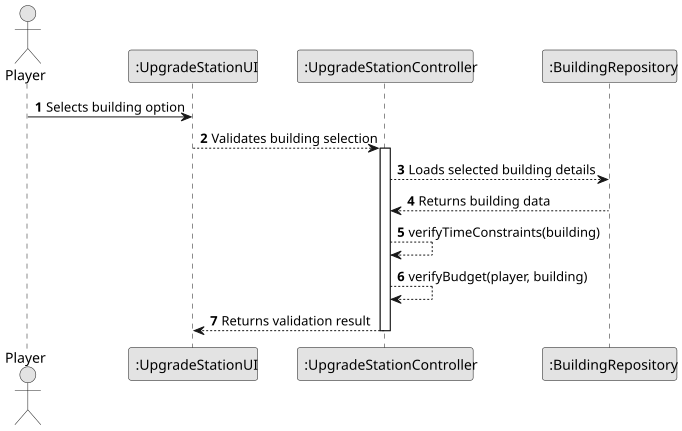
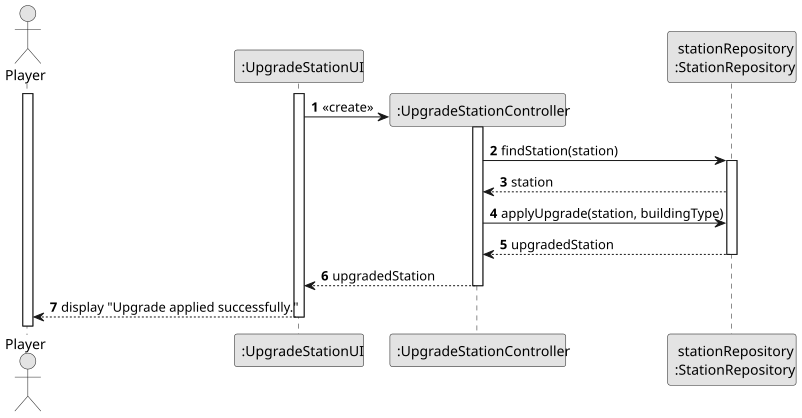
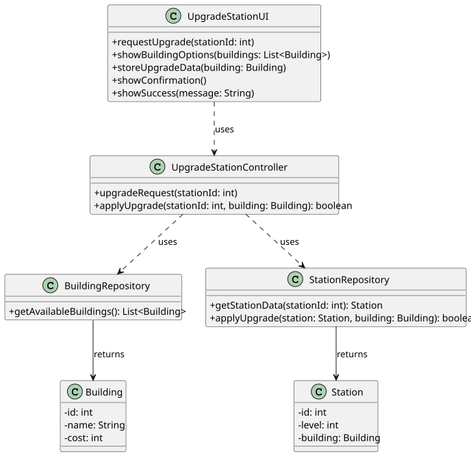

# US006 - Upgrade a Station With a Building

## 3. Design

### 3.1. Rationale

**The rationale grounds on the SSD interactions and the identified input/output data.**

| Interaction ID                         | Question: Which class is responsible for...                        | Answer                   | Justification (with patterns) |
|:---------------------------------------|:-------------------------------------------------------------------|:-------------------------|:------------------------------|
| **Step 1 - Request Upgrade**           | ...instantiating the class that handles the UI?                    | UpgradeStationUI         | Pure Fabrication              |
|                                        | ...coordinating the US?                                            | UpgradeStationController | Controller                    |
| **Step 2 - Select Station and Option** | ...displaying the form/options for the actor to select an upgrade? | UpgradeStationUI         | Pure Fabrication              |
|                                        | ...validating the selected building upgrade?                       | UpgradeStationUI         | Pure Fabrication              |
|                                        | ...loading the available building types?                           | BuildingRepository       | Information Expert            |
|                                        | ...checking building restrictions and compatibility?               | Building                 | Information Expert            |
|                                        | ...ensuring there is no conflict in upgrade exclusivity?           | Station                  | Information Expert            |
| **Step 3 - Apply Upgrade**             | ...applying the upgrade (adding the building to the station)?      | StationRepository        | Creator                       |
|                                        | ...displaying the operation success message?                       | UpgradeStationUI         | Pure Fabrication              |

### Systematization ##

According to the taken rationale, the conceptual classes promoted to software classes are:

* Repositories
* StationRepository
* BuildingRepository
* Station
* Building

Other software classes (i.e. Pure Fabrication) identified:

* UpgradeStationUI
* UpgradeStationController

## 3.2. Sequence Diagram (SD)

_In this section, it is suggested to present a UML dynamic view representing the sequence of interactions between software objects that allows to fulfill the requirements._

### Full Diagram

This diagram shows the full sequence of interactions between the classes involved in the realization of this user story.

### Split Diagrams

The following diagram shows the same sequence of interactions between the classes involved in the realization of this user story, but it is split in partial diagrams to better illustrate the interactions between the classes.

It uses Interaction Occurrence (a.k.a. Interaction Use).

**Get Input Partial SD**

**Validate Upgrade Partial SD**

**Apply Upgrade and Display Success Partial SD**

## 3.3. Class Diagram (CD)

_In this section, it is suggested to present an UML static view representing the main related software classes that are involved in fulfilling the requirements as well as their relations, attributes and methods._

