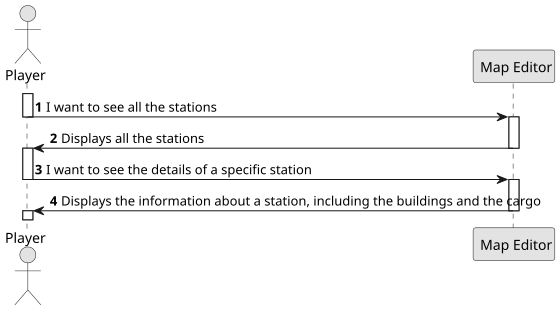
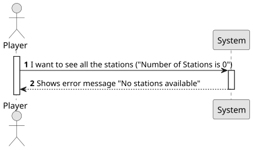

# US007 - Checking the stations and their details

## 1. Requirements Engineering

### 1.1. User Story Description

As a Player, I want to list all the stations to select one to see its details, including the existing building and the demand/supply cargoes.

### 1.2. Customer Specifications and Clarifications

**From the specifications document:**

> The player should be able to check every detail of a station, including all the buildings and all the cargo associated to that station. 
The buildings include telegraphs, cafés, customs, post offices, hotels (that can be either large or small), silos, liquid storage as well as the cargo that is ready for collection and the one that needs to be delivered.

**From the customer's clarifications:**
> - What information should be visible directly in the list? Just the station name, or also other details like type, location, and operational status (active/inactive), etc.? Answer: name and a summary of available cargos to be collected and the ones that are demanded
>
> 
> - Besides the existing buildings and demand/supply cargo, are there any other details that should be shown when viewing a station's information? For example, location, capacity, or operational status? Answer: available cargos to be collected and the ones that are demanded
> 
> 
> - When the user selects an existing station, does it automatically show all the associated info to that station or the user selects the station then has to select the required option ? eg: 'show details'. Answer: That's a matter of UX/UI, each team can decide what works best.

### 1.3. Acceptance Criteria

* There are no acceptance criteria for this User Story

### 1.4. Found out Dependencies

* This User Story requires the US05. This happens, since in order to list all the stations, there need to be stations created.

### 1.5 Input and Output Data

**Input Data:**
- Selected Data:
  - Station

**Output Data:**

- Listing of all the stations, with their associated building and their supply/demand cargoes.

### 1.6. System Sequence Diagram (SSD)

#### Success Case

#### Action Error: Not Enough Budget

### 1.7 Other Relevant Remarks

- None