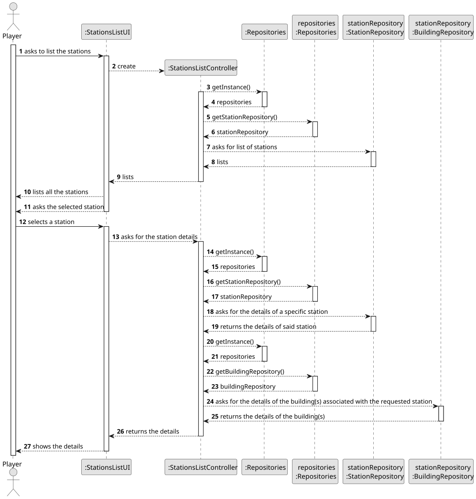
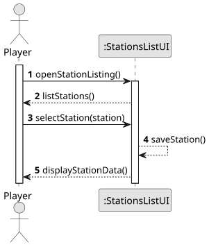
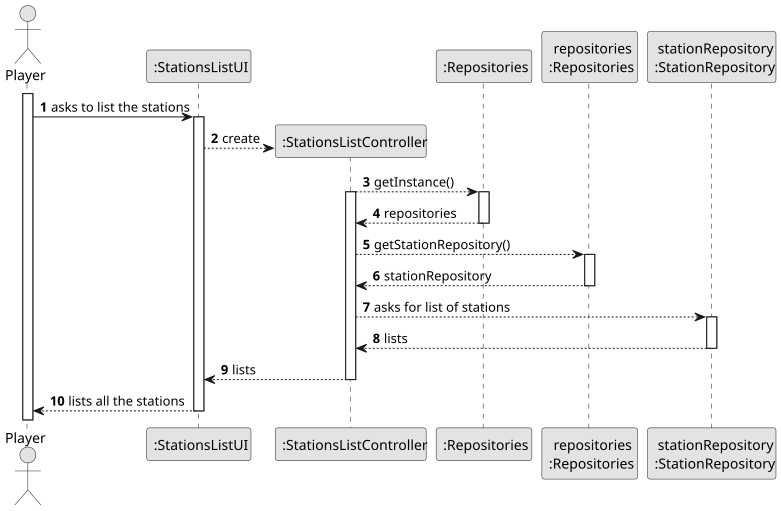
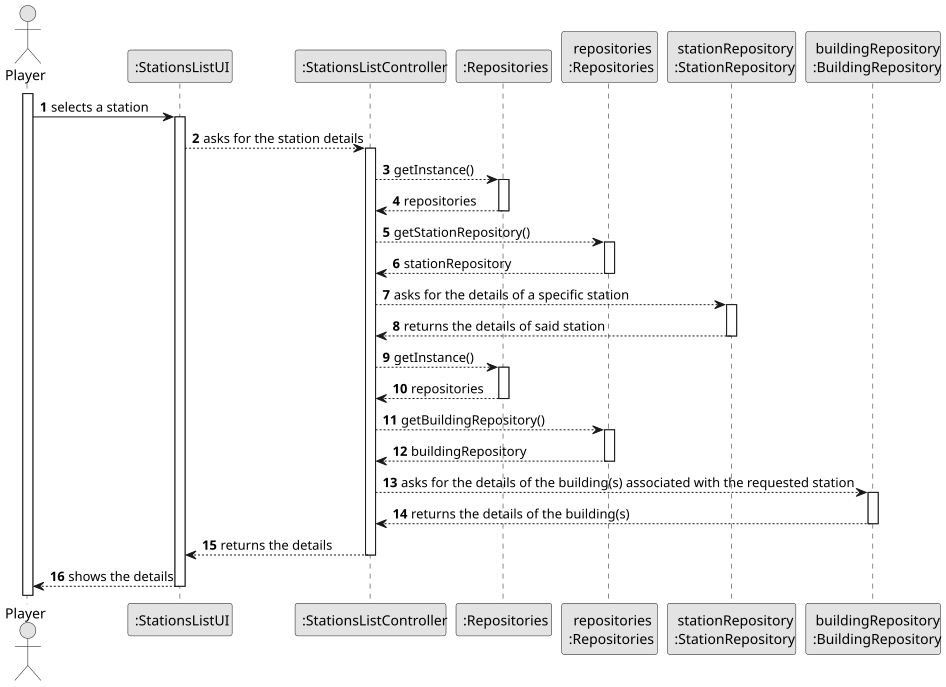
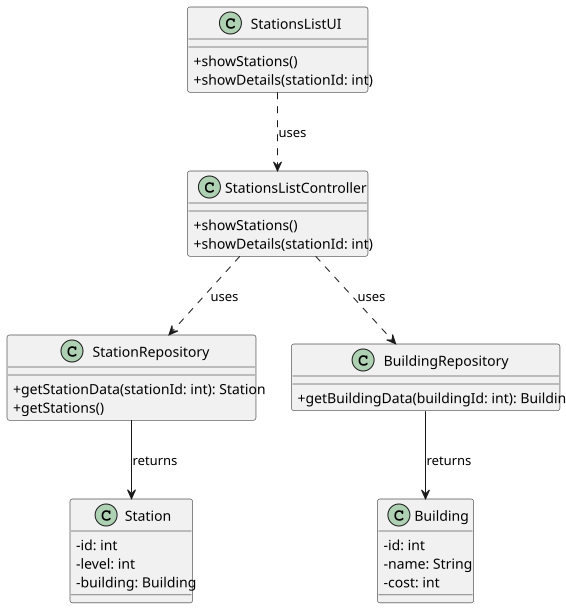

# US007 - List Stations and View Details

## 3. Design

### 3.1. Rationale

**The rationale is based on the SSD interactions and the identified input/output data.**

| Interaction ID                       | Question: Which class is responsible for...                    | Answer                 | Justification (with patterns) |
| :----------------------------------- | :------------------------------------------------------------- | :--------------------- | :---------------------------- |
| **Step 1 - Request Stations List**   | ...coordinating the user story?                                | StationsListController | Controller                    |
|                                      | ...displaying the list of available stations?                  | StationsListUI         | Pure Fabrication              |
|                                      | ...retrieving the station list?                                | StationRepository      | Information Expert            |
| **Step 2 - Request Station Details** | ...receiving the selected station and saving it?               | StationsListUI         | Pure Fabrication              |
|                                      | ...coordinating the detail retrieval?                          | StationsListController | Controller                    |
|                                      | ...retrieving the station details (core info)?                 | StationRepository      | Information Expert            |
|                                      | ...retrieving the associated building details?                 | BuildingRepository     | Information Expert            |
|                                      | ...presenting the station details and buildings to the player? | StationsListUI         | Pure Fabrication              |

### Systematization

According to the taken rationale, the conceptual classes promoted to software classes are:

* **StationRepository**
* **BuildingRepository**
* **Station**
* **Building**

Other software classes (i.e., Pure Fabrication) identified:

* **StationsListUI**
* **StationsListController**

## 3.2. Sequence Diagram (SD)

*This section presents a UML dynamic view representing the sequence of interactions between software objects that allow fulfilling the requirements.*

### Full Diagram

This diagram shows the full sequence of interactions between the classes involved in the realization of this user story. It captures the main flow starting from the player's request to view the stations, retrieving the list, handling station selection, and fetching and presenting the corresponding station and building details.

### Split Diagrams

The following diagrams illustrate the same sequence of interactions, split into partial diagrams for clarity. These use **Interaction Occurrence** (a.k.a. **Interaction Use**).

**Get Input Partial SD**

This diagram represents the interactions where the player initiates the process to list stations and selects one for detailed viewing.

**List Stations Partial SD**

This diagram focuses on retrieving the list of available stations from the repository and displaying it to the user.

**Get Building Details Partial SD**

This diagram covers retrieving detailed information about the selected station and its associated buildings.

## 3.3. Class Diagram (CD)

*This section presents a UML static view representing the main related software classes involved in fulfilling the requirements.*

This class diagram shows the core software classes responsible for supporting the listing and detailed viewing of stations. It includes the UI, controller, repositories, and the domain classes `Station` and `Building`. The diagram highlights the key attributes and public methods as well as the relationships between these classes that support the user story execution.

