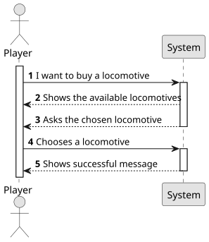

# US009 - Buying a train

## 1. Requirements Engineering

### 1.1. User Story Description

As a Player, I want to buy a locomotive.

### 1.2. Customer Specifications and Clarifications

**From the specifications document:**

> The player should choose a train from a list of available trains.  Different trains have different fuel consumption, namely electricity, steam and diesel.  Also, Some types of trains require special rails to operate.

**From the customer's clarifications:**
> - I saw that in the US referenced, there's a dependency referring to a list of available locomotives for the scenario and current date. However, I didn't find any specific User Story that mentions the construction or exhibition of that list. Will that list functionality be detailed in the future? (Adapted from portuguese) Answer: The locomotives that will be presented in the selection list are restricted to the current date and any restrictions that may have been defined in the scenario.
    The presentation of the list of locomotives is part of US09.
> 
> 
> - Can a player buy the same train multiple times? Answer: the same type of locomotive, yes; but these locomotives will have unique identification (like a plate or a serial number)
>
> 
> - Is there a limit to how many trains a player can own, like a inventory that can get full? Answer: there is no physical limit, just the available memory.
>
> 
> - How is the availability of locomotives determined? Answer: Each locomotive model has a one-year entry into service period, after which it becomes available for purchase.
> 
> 
> - Monetary data is expressed in any particular currency? Answer: An abstract one.
> 
> 
> - What happens if the player does not have enough budget to buy a locomotive? Answer: He can't buy! Bonds and loans will not be considered right now
>
> 
> - Is there a limit to the number of locomotives a player can buy? Answer: No limit
> 
> 
> - Why is the current date required when buying a locomotive? Answer: Already answered in the first point.

### 1.3. Acceptance Criteria

* AC01: The player should choose the locomotive from a list of available locomotives for the scenario as well as a current date

### 1.4. Found out Dependencies

* This User Store requires the US01. In order to buy a train, the player needs to have a map and a railway.

### 1.5 Input and Output Data

**Input Data:**

- Selected Data:
  - Train type

**Output Data:**

- Success Message

### 1.6. System Sequence Diagram (SSD)

### 1.7 Other Relevant Remarks

- None