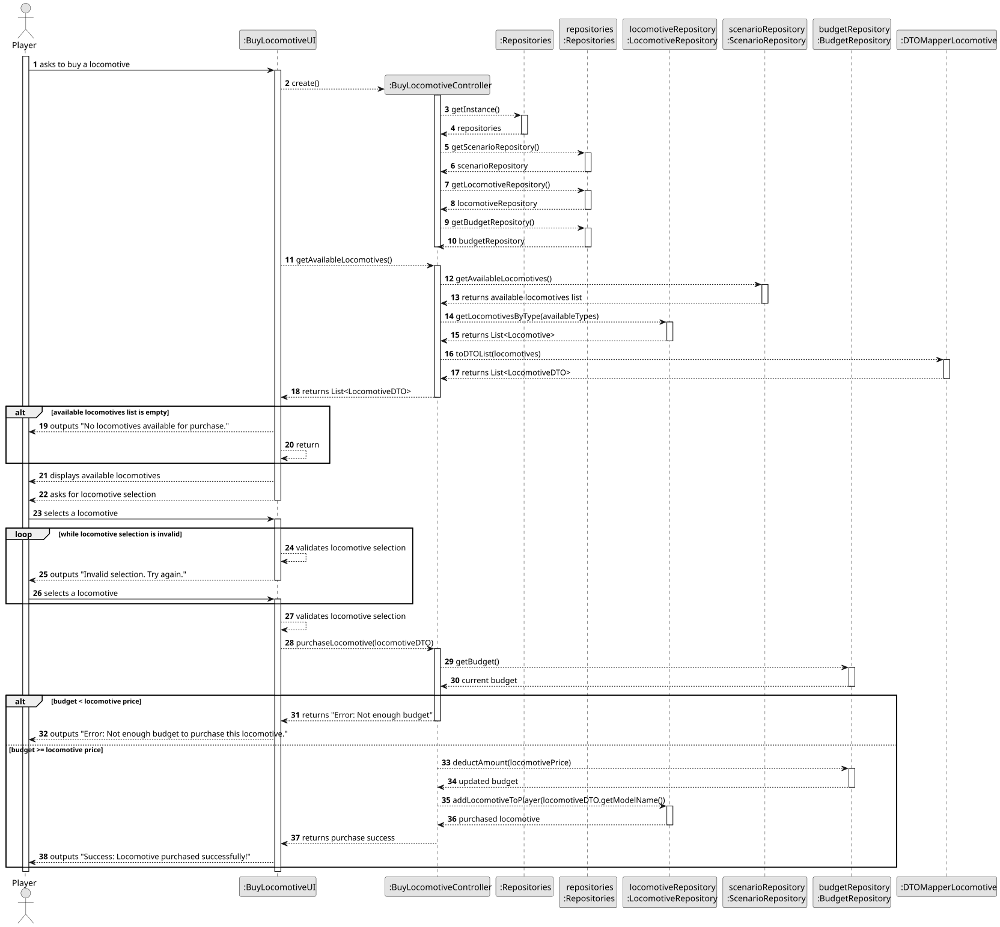
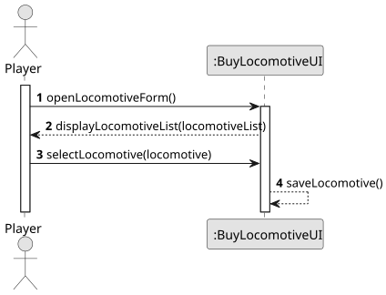
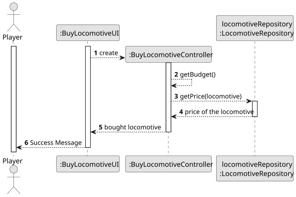
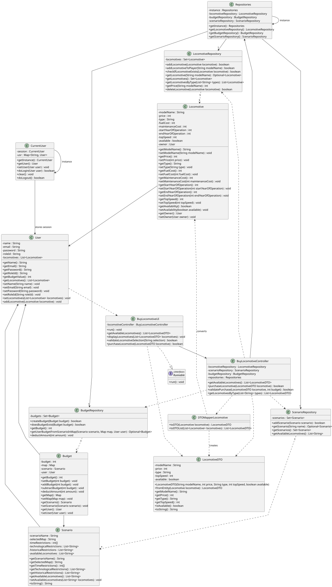

# US009 - Buy a Locomotive

## 3. Design

### 3.1. Rationale

**The rationale grounds on the SSD interactions and the identified input/output data.**

| Interaction ID                           | Question: Which class is responsible for...                            | Answer                  | Justification (with patterns) |
| :--------------------------------------- | :--------------------------------------------------------------------- | :---------------------- | :---------------------------- |
| **Step 1 - Request Locomotive Purchase** | ...instantiating the class that handles the UI?                        | BuyLocomotiveUI         | Pure Fabrication              |
|                                          | ...coordinating the user story?                                        | BuyLocomotiveController | Controller                    |
|                                          | ...providing available locomotives per scenario?                       | ScenarioRepository      | Information Expert            |
|                                          | ...providing detailed locomotive data (matching scenario locomotives)? | LocomotiveRepository    | Information Expert            |
| **Step 2 - Select Locomotive**           | ...displaying available locomotives?                                   | BuyLocomotiveUI         | Pure Fabrication              |
|                                          | ...storing selected locomotive?                                        | BuyLocomotiveUI         | Pure Fabrication              |
| **Step 3 - Confirm Purchase**            | ...getting price and budget details?                                   | BuyLocomotiveController | Controller                    |
|                                          | ...calculating price of selected locomotive?                           | LocomotiveRepository    | Information Expert            |
|                                          | ...checking budget for purchase validation?                            | BuyLocomotiveController | Information Expert            |
|                                          | ...completing the purchase?                                            | LocomotiveRepository    | Creator                       |
|                                          | ...displaying result of the operation (success/failure)?               | BuyLocomotiveUI         | Pure Fabrication              |

### Systematization

According to the taken rationale, the conceptual classes promoted to software classes are:

* **LocomotiveRepository**
* **ScenarioRepository**
* **Locomotive**
* **Scenario**

Other software classes (i.e. Pure Fabrication) identified:

* **BuyLocomotiveUI**
* **BuyLocomotiveController**

## 3.2. Sequence Diagram (SD)

*In this section, a UML dynamic view presents the sequence of interactions between software objects that fulfill the user story.*

### Full Diagram

This diagram shows the full sequence of interactions between the classes involved in realizing this user story, from the request to buy a locomotive to the final confirmation or rejection based on budget.

### Split Diagrams

The sequence is also presented using **partial diagrams**, organized by interaction segments and **Interaction Occurrences (Interaction Use)**.

**Get Input Partial SD**

This diagram covers the initial interaction with the player and lists the available locomotives.

**Buy and Display Success Partial SD**

This partial diagram handles the logic of selecting a locomotive, price validation, budget check, and displaying the success or failure of the purchase.

## 3.3. Class Diagram (CD)

*This section presents a UML static view of the main related software classes, their responsibilities, attributes, and associations.*

