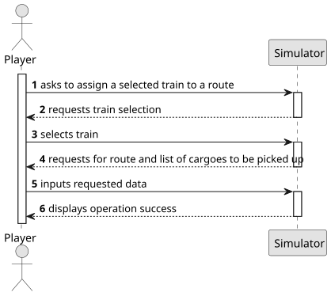

# US010 - Assign a selected train to a route

## 1. Requirements Engineering

### 1.1. User Story Description
As a Player, I want to assign a selected train to a route with a valid station and the respective list of cargoes to be picked up

### 1.2. Customer Specifications and Clarifications

#### From the customer's clarifications:
> Question: When a train reaches the end of the route does it come back through the same path? What if the route ends at the starting point? Or alternatively should routes always be circular?
> Answer:
> 
> Question: Should the route be defined one station at a time, or through a list of stations and cargo changes?
> Answer:
> 
> Question: Should we be able to assign multiple trains to the same route?
> Answer:
> 
> Question: What happens if the trains pick up resources that aren't needed at the next station?
> Answer:
> 
> Question: A route is a list of stations where the train passes. If there are many stations but no railway lines, are we able to create a route?
> Answer: If there is no path between any pair of consecutive points of the route, the player should be warned, then the player can opt between cancel/proceed.
> 
> Question: Can multiple cargo types be assigned to the same train? Does a route have a limit of stations that can be assigned?
> Answer: Yes; No.

#### From the specifications document:
> Railway Lines allow the connection of two stations. In the context of this
project, it is not intended to make a detailed graphical edition of the route,
but only a topological representation of the connection between two stations.
A line has a certain length, can be single or double, and can be electrified
(or not).
>
> In the simulator, the player/user acquires trains within the available budget
and can put the train into service on a specific route. A route is a list of
stations where the train passes, along which it loads (carriages) cargo at each
station.
>
> In addition to creating the dynamic elements already described, the player/user
can play or pause the simulator. During the simulator’s operation, the evolution of events should be displayed, namely the trains’ journeys (start and
end).

### 1.3. Acceptance Criteria
- In this version there is no acceptance criteria.

### 1.4. Found Dependencies
- This user story has dependencies with US008 - "Build a railway line between two stations" and US009 - "Buying a train" as the player has to have a train in possession and a valid route has to exist.

### 1.5. Input and Output Data

#### Input Data:
- Selected Data:
  - Selected train
  - Route
  - List of cargoes to be picked up

#### Output Data:
- Confirmation of successful operation
- Error message if operation fails (e.g., invalid train, route or cargo)

### 1.6. System Sequence Diagram (SSD)

**_Other alternatives might exist._**

### 1.7. Other Relevant Remarks
- None.