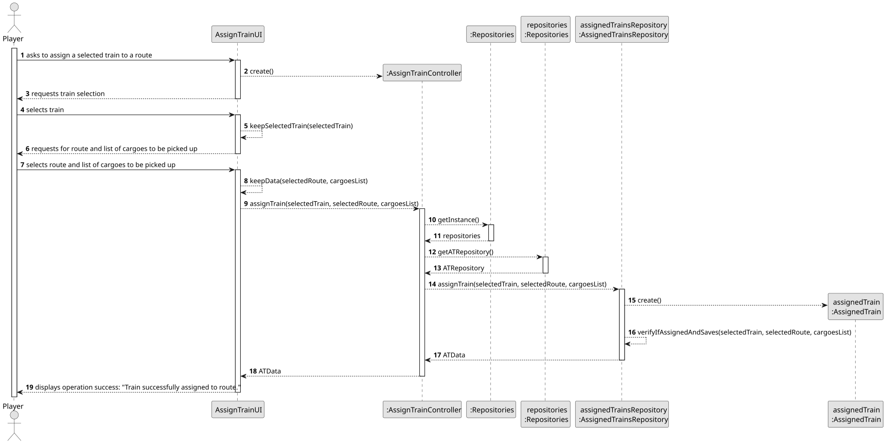

# US010 - Assign a selected train to a route

## 3. Design

### 3.1. Rationale

**The rationale grounds on the SSD interactions and the identified input/output data.**

| Interaction ID                           | Question: Which class is responsible for...                | Answer                   | Justification (with patterns)        |
|:-----------------------------------------|:-----------------------------------------------------------|:-------------------------|:-------------------------------------|
| Step 1 - Asks to assign train to route		 | ...instantiating the class that handles the UI?							     | AssignTrainUI            | Pure Fabrication                     |
| 		                                       | ...coordinating the US?							                             | AssignTrainController    | Controller                           |
| Step 2 - Requests user data  		          | ...displaying the form for the actor to input data?							 | AssignTrainUI            | Pure Fabrication                     |
| Step 3 - Types/selects user data  		                               | ...validating typed/selected data?							                  | AssignTrainUI            | Pure Fabrication                     |
| 		                               | ...temporarily keeping the data?							                    | AssignTrainUI            | Pure Fabrication                     |
|  		                               | ...getting instances of repositories?							               | Repositories             | Information Expert, Pure Fabrication |              
|   		                               | ...get assigned trains repository?							                  | Repositories             | Information Expert, Pure Fabrication |
|   		                               | ...creating the assignedTrain Object?							               | AssignedTrainsRepository | Creator                              |
|  		                               | ...validating the data locally?							                     | AssignedTrain            | Information Expert                   |
|  		                              | ...return the assigned train's data?							                | AssignedTrainsRepository | Information Expert, Pure Fabrication |  
|  		                              | ...displaying operation success message?							                | AssignTrainUI            | Pure Fabrication |  

### Systematization ##

According to the taken rationale, the conceptual classes promoted to software classes are:

* Repositories
* AssignedTrainsRepository
* AssignedTrain

Other software classes (i.e. Pure Fabrication) identified:

* AssignTrainUI
* AssignTrainController

## 3.2. Sequence Diagram (SD)

_In this section, it is suggested to present an UML dynamic view representing the sequence of interactions between software objects that allows to fulfill the requirements._

## 3.3. Class Diagram (CD)

_In this section, it is suggested to present an UML static view representing the main related software classes that are involved in fulfilling the requirements as well as their relations, attributes and methods._

