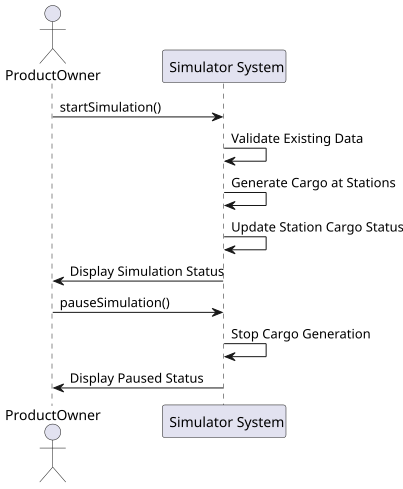

# US012 - Create a simulator

## 1. Requirements Engineering

### 1.1. User Story Description
As a Product Owner, I want to create a simulator that generates cargoes at current stations, automatically, considering the cities and industries that the railway network serves. AC1: This simulator should provide options for start/pause.

### 1.2. Customer Specifications and Clarifications

#### From the specifications document:
> The simulator will enable the manager (or in the playful perspective, the
player) to create a railway network composed of stations that serve cities
and industries, lines connecting those stations, and trains that transport
cargo between stations, according to a route defined by the manager. It
is crucial to highlight that cities and industries only generate or transform
cargo if they have a station; when the cargo is generated, it is then available
to be collected at the station.
> 
> In addition to creating the dynamic elements already described, the player/user
can play or pause the simulator. During the simulator’s operation, the evolution of events should be displayed, namely the trains’ journeys (start and
end).
> 
> This system may be used by different users, namely:
> 
>• Editor - a person who can create maps and scenarios that can be provided in a bundle with the game or sold separately.
> 
>• Player – a person who wants to play a game; in advanced versions, a
scenario can be played by multiple players simultaneously.

### 1.3. Acceptance Criteria
-  AC1: This simulator should provide options for start/pause.

### 1.4. Found Dependencies
- This user story has dependencies with all user stories as they're all needed to create the simulator.

### 1.5. Input and Output Data

#### Input Data:
- Existing railway network data
- Scenario configurations
- Simulation controls

#### Output Data:
- Cargo generation at stations
- Simulation operation feedback

### 1.6. System Sequence Diagram (SSD)

**_Other alternatives might exist._**

### 1.7. Other Relevant Remarks
- None.