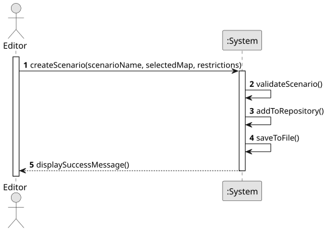

# US021 - Save a Scenario

## 1. Requirements Engineering

### 1.1. User Story Description
As an Editor, I want to save a scenario in a file for later use. The system should allow me to persist scenario data including all of his restrictions (time, technological, and historical) and associated map information.
### 1.2. Customer Specifications and Clarifications

#### From the specifications document:
> The application needs to contain object serialization to guarantee the persistence of the data in two successive runs. All scenario data including time restrictions, technological restrictions, and historical restrictions must be stored for later use.

### 1.3. Acceptance Criteria
-  AC1: The scenario must be saved with all its properties (name, selected map, time restrictions, technological restrictions, historical restrictions).
- AC2: The system must validate that the scenario exists and has valid data before attempting to save.
### 1.4. Found Dependencies
- This User Story has a dependency with US01 "Create a Map" because scenarios are associated with maps.
- This User Story has a dependency with US04 "Create a Scenario" because a scenario must exist before it can be saved.

### 1.5. Input and Output Data

#### Input Data:
- The Scenario that will be saved into the file

### 1.6. System Sequence Diagram (SSD)

### 1.7. Other Relevant Remarks
- None.