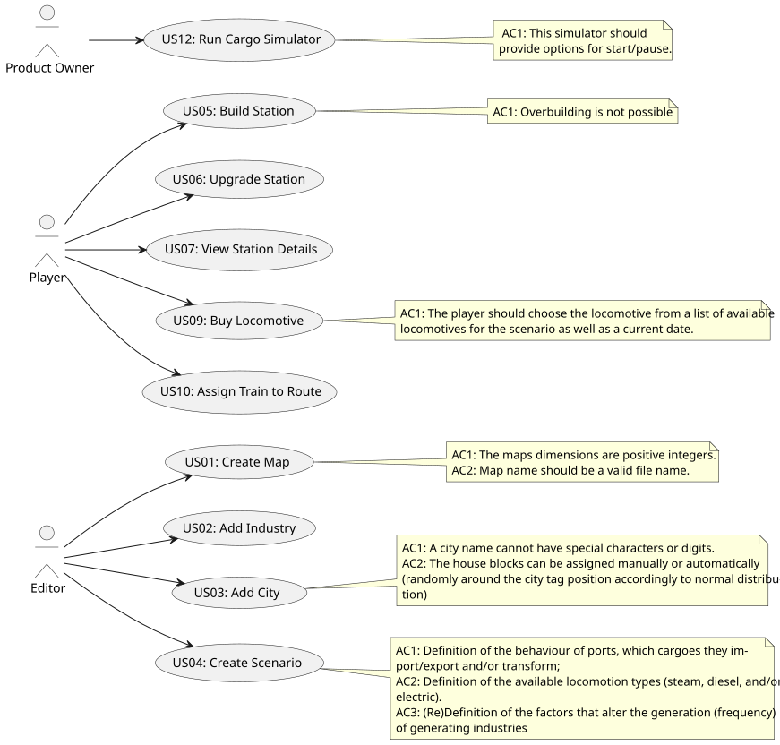

# Use Case Diagram (UCD)

**In the scope of this project, there is a direct relationship of _1 to 1_ between Use Cases (UC) and User Stories (US).**

However, be aware, this is a pedagogical simplification. On further projects and course units there may also exist _1 to N **and/or** N to 1_ relationships between UC and US.

**Insert below the Use Case Diagram in a SVG format**

**For each UC/US, it must be provided evidences of applying main activities of the software development process (requirements, analysis, design, tests and code). Gather those evidences on a separate file for each UC/US and set up a link as suggested below.**

# Use Cases / User Stories

| UC/US | Description                                                            |                   
|:------|:-----------------------------------------------------------------------|
| US001 | [Create a Map](../../US001/US001-README.md)                            |
| US002 | [Add an Industry to the Map](../../US002/US002-README.md)              |
| US003 | [Add a City to the Map](../../US003/US003-README.md)                   |
| US004 | [Create a Scenario](../../US004/US004-README.md)                       |
| US005 | [Build a Station](../../US005/US005-README.md)                         |
| US006 | [Upgrade a Station With a Building](../../US006/US006-README.md)       |
| US007 | [Checking the stations and their details](../../US007/US007-README.md) |
| US009 | [Buying a train](../../US009/US009-README.md)                          |
| US010 | [Assign a selected train to a route](../../US010/US010-README.md)      |
| US012 | [Create a Simulator](../../US012/US012-README.md)                          |
